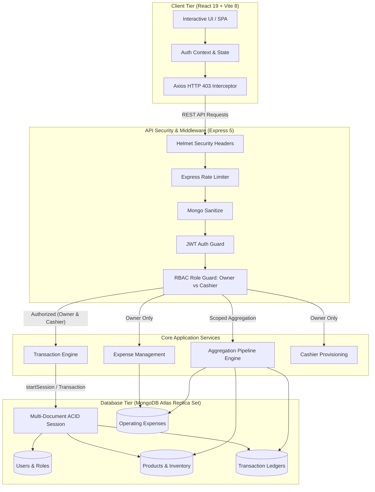
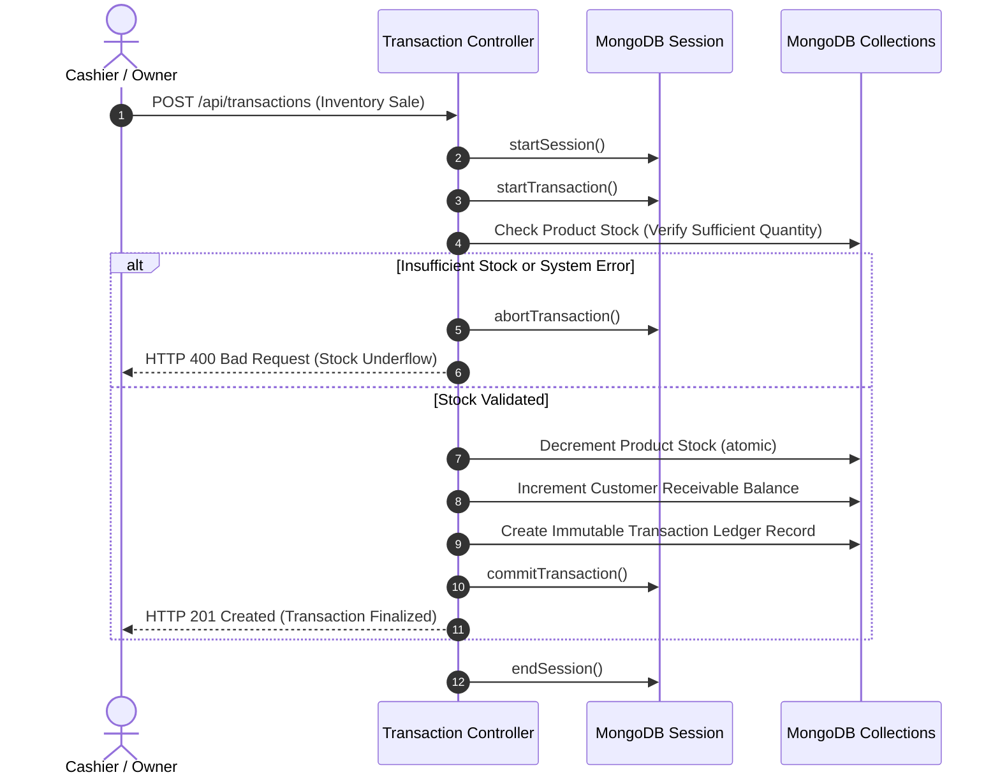

<div align="center">

# 📊 ShopLedger V2

**Enterprise Digital Khata, Real-Time Inventory & Executive Profit Intelligence Platform**

*Engineered for modern retail, wholesale, and service enterprises.*

[](https://github.com/Ahsan-Qamar-47/shopledger/actions/workflows/ci.yml)
[](https://github.com/Ahsan-Qamar-47/shopledger/releases)
[](LICENSE)
[](https://nodejs.org/)
[](https://react.dev/)
[](https://expressjs.com/)
[](https://www.mongodb.com/)
[](https://tailwindcss.com/)
[](CONTRIBUTING.md)

[Live Demo](https://shopledger.vercel.app) • [API Health](https://shopledger-api.onrender.com/api/health) • [Project Report](V2_PROJECT_REPORT.md) • [Demo Script](DEMO_SCRIPT.md) • [Deployment Guide](DEPLOYMENT.md)

</div>

---

## 🌟 Executive Overview

**ShopLedger V2** transforms traditional single-user digital ledger software into a hardened, multi-tenant enterprise khata and financial intelligence suite. Designed for retail and service business operations, V2 bridges the gap between fast-paced cash register transactions and executive-level bookkeeping.

Traditional khata apps record sales as loose, isolated documents—leaving shops vulnerable to race conditions, orphaned balances during network drops, and untracked operational overhead. **ShopLedger V2 solves this** by pairing multi-document **ACID transactions** with strict **Role-Based Access Control (RBAC)**, real-time aggregation pipelines, and comprehensive operating expense tracking.

---

## 🚀 Live Deployments & Demo Accounts

Explore the live production environment deployed on the **Vercel Edge Network** (Frontend) and **Render** (Backend API):

| Service | Endpoint URL | Status |
| :--- | :--- | :--- |
| **Frontend Application** | [https://shopledger.vercel.app](https://shopledger.vercel.app) | Production (Vercel) |
| **Backend REST API** | [https://shopledger-api.onrender.com/api](https://shopledger-api.onrender.com/api) | Production (Render) |
| **Health Check Monitor** | [https://shopledger-api.onrender.com/api/health](https://shopledger-api.onrender.com/api/health) | 200 OK |

### 🔐 Pre-Seeded Interactive Demo Credentials

| Role | Email | Password | Scope & Authorization |
| :--- | :--- | :--- | :--- |
| **Shop Owner** | `owner@demo.com` | `Password123!` | **Full Executive Access**: Net Income, Gross Profit, Expense CRUD, Staff Provisioning, Audit Trails, Recharts Analytics. |
| **Cashier Terminal** | `cashier@demo.com` | `Password123!` | **Operational Floor Terminal**: Product lookup, customer receivables, sales recording. Strictly blocked from financial profits and overhead costs. |

---

## 🏗️ System Architecture & Data Flow



---

## ⚡ Core Engineering Highlights

### 1. Multi-Document ACID Transactions
In high-throughput retail, network interrupts or concurrent updates can corrupt financial ledgers. ShopLedger V2 implements MongoDB Replica Set sessions (`mongoose.startSession()`):
- **Atomic Execution**: Inventory decrement, customer balance increment, and transaction creation execute inside a single transaction boundary.
- **Automatic Rollback**: Any error (e.g. stock underflow, validation failure) triggers `session.abortTransaction()`, ensuring zero dirty writes or phantom ledger balances.



### 2. Role-Based Access Control (RBAC)
Strict separation between strategic financial ownership and frontline cashier operations:
- **`Owner`**: Full managerial control, viewing gross margin, overhead operating expenses, net income, and creating subordinate staff.
- **`Cashier`**: Isolated point-of-sale terminal with restricted access. Blocked at both UI layer (navigation guards) and API layer (`middleware/rbac.js`). Direct attempts to access owner routes return `HTTP 403 Forbidden`.

### 3. Financial Intelligence Engine (Net Income Pipeline)
True profitability requires accounting for overhead expenses. V2 computes:
$$\text{Gross Profit} = \sum (\text{Selling Price} - \text{Cost Price}) \times \text{Quantity}$$
$$\text{Net Income} = \text{Gross Profit} - \sum \text{Operating Expenses}$$
- Dynamic filtering across `Today`, `This Week`, and `This Month`.
- Interactive 30-day historical net income and gross profit area charts powered by **Recharts**.

### 4. Hybrid Inventory & Service Sales Paradigm
Retailers frequently offer pure labor and services (repairs, alterations, delivery fees) alongside physical goods:
- **Inventory Sale (`isInventorySale: true`)**: Decrements physical stock and accounts for Cost of Goods Sold (COGS).
- **Service Sale (`isInventorySale: false`)**: Bypasses inventory depletion entirely, treating the fee as 100% gross profit.

### 5. Zero Cold-Start Keepalive Architecture
Render free-tier instances hibernate after 15 minutes of inactivity. ShopLedger solves this via:
- Built-in Node.js uptime ping daemon (`server/scripts/uptimePing.js`).
- Scheduled GitHub Actions cron workflow (`.github/workflows/keepalive.yml`) pinging `/api/health` every 10 minutes, guaranteeing instant load times.

---

## 🛡️ RBAC Permission Matrix

| Feature / Resource | Route / Action | Owner Role | Cashier Role |
| :--- | :--- | :---: | :---: |
| **Sales & POS Terminal** | `POST /api/transactions` | Full Access | Full Access |
| **Inventory Lookup** | `GET /api/products` | View Cost & Selling Price | View Selling Price Only |
| **Inventory Stock Management**| `POST/PUT /api/products` | Full Access | Blocked (403) |
| **Customer Receivables** | `GET/POST /api/customers` | Full Access | Full Access |
| **Customer Statements & PDF** | `GET /api/customers/:id/statement`| Full Access | Full Access |
| **Cashier Dashboard Stats** | `GET /api/dashboard/cashier-stats` | Full Access | Scoped (No Margins) |
| **Executive Financial Metrics**| `GET /api/dashboard/stats` | Full Access | **Blocked (403)** |
| **30-Day Trend Chart** | `GET /api/dashboard/profit-trend` | Full Access | **Blocked (403)** |
| **Operating Expenses CRUD** | `GET/POST/DELETE /api/expenses` | Full Access | **Blocked (403)** |
| **Cashier Staff Provisioning** | `POST /api/auth/register-cashier`| Full Access | **Blocked (403)** |

---

## 📊 V1 vs V2 Evolution Matrix

| Capability | Version 1.0 (Baseline) | Version 2.0 (Enterprise) |
| :--- | :--- | :--- |
| **Transaction Integrity** | Non-atomic single document writes | **Multi-Document ACID Transactions** (`mongoose.startSession`) |
| **User Roles & Security** | Single role (all users have full access) | **Hierarchical RBAC** (`Owner` vs `Cashier`) with 403 interceptor |
| **Sales Flexibility** | Physical inventory stock decrement only | **Dual Flow**: Atomic Inventory Sales + Service/Labor Sales |
| **Expense Tracking** | Not supported | **Full Expense CRUD** (Rent, Utilities, Salaries) with soft delete |
| **Profit Analytics** | Basic revenue calculation | **Real-Time Net Income Engine** (`Gross Profit - Expenses`) |
| **Date Range Filtering** | Static lifetime totals | **Dynamic Timeframes** (`Today`, `This Week`, `This Month`) |
| **Analytics Visuals** | Static numeric summary cards | **Interactive 30-Day Gross Profit Trend Chart** (Recharts) |
| **Instance Reliability** | 50s free-tier cold starts on Render | **Zero Cold-Start Keepalive Daemon & GitHub Actions Cron** |
| **Design Language** | Standard emoji-accented UI | **Zero-Emoji Design System** (Plus Jakarta Sans, Fraunces, Lucide) |

---

## 🛠️ Complete REST API Reference

### Authentication & Staff Management (`/api/auth`)
| Method | Endpoint | Auth | Role | Description |
| :--- | :--- | :---: | :---: | :--- |
| `POST` | `/api/auth/register` | Public | None | Register a new business and default `Owner` account |
| `POST` | `/api/auth/login` | Public | None | Authenticate credentials; returns JWT with role payload |
| `GET` | `/api/auth/me` | Bearer JWT | Any | Get current authenticated user session data |
| `POST` | `/api/auth/register-cashier` | Bearer JWT | `Owner` | Provision a new `Cashier` account assigned to shop |
| `GET` | `/api/auth/cashiers` | Bearer JWT | `Owner` | List all provisioned cashiers for the shop |

### Financial & Operational Dashboard (`/api/dashboard`)
| Method | Endpoint | Auth | Role | Description |
| :--- | :--- | :---: | :---: | :--- |
| `GET` | `/api/dashboard/stats` | Bearer JWT | `Owner` | Real-time Net Income, Gross Profit, Sales, and Expenses (supports `?timeframe=today\|week\|month`) |
| `GET` | `/api/dashboard/profit-trend` | Bearer JWT | `Owner` | 30-day historical gross profit and net income time-series |
| `GET` | `/api/dashboard/cashier-stats`| Bearer JWT | `Cashier`| Operational daily sales, receivables balance, and low-stock alerts |

### Overhead Expense Management (`/api/expenses`)
| Method | Endpoint | Auth | Role | Description |
| :--- | :--- | :---: | :---: | :--- |
| `GET` | `/api/expenses` | Bearer JWT | `Owner` | List active operating expenses with category filters |
| `POST` | `/api/expenses` | Bearer JWT | `Owner` | Create a new operating expense (Rent, Utilities, Salary, etc.) |
| `DELETE` | `/api/expenses/:id` | Bearer JWT | `Owner` | Soft-delete an expense record (`isActive: false`) |

### Transactions & Sales Ledger (`/api/transactions`)
| Method | Endpoint | Auth | Role | Description |
| :--- | :--- | :---: | :---: | :--- |
| `GET` | `/api/transactions` | Bearer JWT | Any | Query immutable transaction ledger with pagination |
| `POST` | `/api/transactions` | Bearer JWT | Any | Process sale or payment via ACID transaction session |

### System & Health (`/api/health`)
| Method | Endpoint | Auth | Role | Description |
| :--- | :--- | :---: | :---: | :--- |
| `GET` | `/api/health` | Public | None | Uptime probe returning memory, database status, and timestamp |

---

## 💻 Local Setup & Quickstart Guide

### Prerequisites
- [Node.js](https://nodejs.org/) `>= 18.0.0`
- [npm](https://www.npmjs.com/) `>= 9.0.0`
- [MongoDB Atlas](https://www.mongodb.com/atlas) Free Tier (M0) or local MongoDB 5.0+ replica set *(Required for multi-document ACID transactions)*

### 1. Clone Repository
```bash
git clone https://github.com/Ahsan-Qamar-47/shopledger.git
cd shopledger
```

### 2. Install Dependencies
Using the root workspace orchestrator:
```bash
npm run install:all
```
*(Or install manually: `cd server && npm install && cd ../client && npm install`)*

### 3. Environment Variables Setup

#### Backend Configuration:
Create `server/.env` based on `server/.env.example`:
```env
PORT=5000
NODE_ENV=development
MONGO_URI=mongodb+srv://<username>:<password>@cluster0.mongodb.net/shopledger?retryWrites=true&w=majority
JWT_SECRET=super_secret_enterprise_jwt_key_32_characters_minimum
JWT_EXPIRE=30d
CLIENT_URL=http://localhost:5173
```

#### Frontend Configuration:
Create `client/.env` based on `client/.env.example`:
```env
VITE_API_URL=http://localhost:5000/api
```

### 4. Database Seeding
Populate initial demo data (Owner, Cashier, Products, Customers, Expenses):
```bash
npm run seed
```

### 5. Launch Development Servers
Run the backend and frontend in separate terminals:

```bash
# Terminal 1: Backend API (runs on port 5000)
npm run dev:server

# Terminal 2: Frontend Client (runs on port 5173)
npm run dev:client
```

Navigate to `http://localhost:5173` in your browser.

---

## 🧪 Automated Testing Suite

ShopLedger V2 includes automated test scripts validating all core features and isolation boundaries:

```bash
# Full Week 3 Day 5 End-to-End Integration Test Suite
npm run test:week3day5

# Week 2 Day 1: RBAC Middleware Pipeline & 403 Verification
npm run test:week2day1

# Week 2 Day 2: Cashier Registration & JWT Role Payload
npm run test:week2day2

# Week 2 Day 3-4: Dashboard Aggregation Pipelines & Net Income
npm run test:week2day3-4

# Week 2 Day 5: Cashier Dashboard Statistics Isolation
npm run test:week2day5

# Week 1: Service Sales & Expense CRUD API Tests
npm run test:week1
```

---

## 📁 Project Directory Structure

```plaintext
shopledger/
├── .github/
│   ├── ISSUE_TEMPLATE/
│   │   ├── bug_report.md             # Standardized bug reporting
│   │   └── feature_request.md        # Feature request template
│   ├── workflows/
│   │   ├── backup.yml                # Automated database backups
│   │   ├── ci.yml                    # Automated build & lint CI workflow
│   │   └── keepalive.yml             # Free-tier 10m keep-alive cron
│   └── PULL_REQUEST_TEMPLATE.md      # Senior PR checklist & guidelines
├── client/                           # Frontend Single Page Application
│   ├── src/
│   │   ├── components/               # Reusable UI components & modals
│   │   │   ├── AddExpenseModal.jsx   # Expense creation modal
│   │   │   ├── AddSaleModal.jsx      # Inventory & Service POS modal
│   │   │   ├── GrossProfitChart.jsx  # 30-Day trend chart (Recharts)
│   │   │   ├── Layout.jsx            # Dynamic navigation & RBAC layout
│   │   │   └── RegisterCashierModal.jsx # Cashier staff registration
│   │   ├── context/
│   │   │   └── AuthContext.jsx       # Auth state, JWT & role provider
│   │   ├── pages/                    # Application page views
│   │   │   ├── Cashiers.jsx          # Cashier management view (Owner)
│   │   │   ├── Dashboard.jsx         # Executive / Cashier dashboard
│   │   │   └── Expenses.jsx          # Expense management view (Owner)
│   │   ├── services/
│   │   │   └── api.js                # Axios client with 403 interceptor
│   │   └── index.css                 # Design system tokens & animations
│   ├── package.json
│   └── vite.config.js
├── server/                           # Backend Node.js / Express API
│   ├── controllers/                  # Business logic & request handlers
│   │   ├── authController.js         # Register, login, cashier provisioning
│   │   ├── dashboardController.js    # Aggregations, metrics, profit trends
│   │   ├── expenseController.js      # Expense CRUD & soft delete
│   │   └── transactionController.js  # ACID transaction execution engine
│   ├── middleware/                   # Security & request interceptors
│   │   ├── auth.js                   # JWT verification middleware
│   │   └── rbac.js                   # Role-Based Access Control guard
│   ├── models/                       # Mongoose schemas
│   │   ├── Expense.js                # Operating expense schema
│   │   ├── Product.js                # Inventory schema with costPrice
│   │   ├── Transaction.js            # Ledger schema with isInventorySale
│   │   └── User.js                   # User schema with Owner/Cashier role
│   ├── routes/                       # Express router definitions
│   ├── scripts/                      # Verification test scripts & pingers
│   ├── server.js                     # Server entrypoint with security middlewares
│   └── seed.js                       # Database demo seeder
├── CHANGELOG.md                      # Version change history (Keep a Changelog)
├── CONTRIBUTING.md                   # Contribution & branch standards
├── DEMO_SCRIPT.md                    # 3-5 minute video walkthrough script
├── DEPLOYMENT.md                     # Step-by-step Render & Vercel deployment
├── LICENSE                           # MIT License
├── package.json                      # Monorepo workspace orchestrator
├── README.md                         # Project documentation
├── render.yaml                       # Render Infrastructure-as-Code Blueprint
├── SECURITY.md                       # Vulnerability reporting & policy
└── V2_PROJECT_REPORT.md              # Academic & Technical Project Report
```

---

## 🤝 Contributing

Contributions are welcome and greatly appreciated! Please read our [Contributing Guidelines](CONTRIBUTING.md) and [Security Policy](SECURITY.md) before opening a pull request.

1. Fork the Project
2. Create your Feature Branch (`git checkout -b feat/AmazingFeature`)
3. Commit your Changes (`git commit -m 'feat(analytics): add export to CSV'`)
4. Push to the Branch (`git push origin feat/AmazingFeature`)
5. Open a Pull Request

---

## 📄 License & Credits

Distributed under the **MIT License**. See [`LICENSE`](LICENSE) for more details.

Crafted by **[Ahsan Qamar](https://github.com/Ahsan-Qamar-47)** & the ShopLedger Engineering Team.
